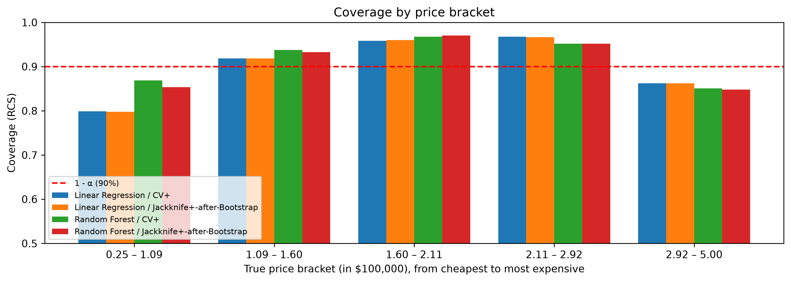

# California Housing – Price Prediction with Conformal Prediction

Predicting house prices in California with **Linear Regression** and **Random Forest**, then building **prediction intervals with a guaranteed coverage** using conformal prediction.

> Group project – Aix-Marseille University (2026–2027)

## Objective

A point prediction alone does not say how reliable it is. With conformal prediction (α = 0.10), the true price should fall inside the predicted interval for about **90% of houses**.

## What the notebook does

All the work is in **`Code.ipynb`**:

1. **Exploration** of the California Housing dataset (scikit-learn): distributions, correlations, map of prices.
2. **Cleaning**: outlier removal with an IQR rule (`src/project_ml/Cleaning.py`) – 20,640 → 19,263 rows.
3. **Models**: Linear Regression and Random Forest (tuned with GridSearchCV).
4. **Conformal prediction**: **CV+** and **Jackknife+-after-Bootstrap**, with a normalized residual as non-conformity score.

## Results

| Model | RMSE | R² |
|---|---|---|
| Linear Regression | 0.636 | 0.688 |
| Random Forest | 0.475 | 0.826 |

| Model / Method | Coverage | Mean interval width |
|---|---|---|
| Linear Regression / CV+ | 90.1% | 2.24 |
| Linear Regression / J+aB | 90.1% | 2.23 |
| Random Forest / CV+ | 91.5% | 1.48 |
| Random Forest / J+aB | 91.1% | 1.47 |



- The 90% coverage is reached **on average**, and Random Forest gives much narrower intervals.
- But coverage is **not uniform**: above 90% for mid-range prices, lower (≈ 80–87%) for the cheapest and most expensive houses.

## Run it

```bash
git clone https://github.com/AubinEspinas/california-housing-conformal-prediction.git
cd california-housing-conformal-prediction
uv sync
```

Then open `Code.ipynb` and select the `.venv` kernel.

## Team

Aubin Espinas ([@AubinEspinas](https://github.com/AubinEspinas)) · Damien Levacher ([@Damien124456](https://github.com/Damien124456)) · Simrat Kaur Khalsa ([@simrat28701](https://github.com/simrat28701))

**Tech stack:** Python · scikit-learn · pandas · NumPy · Matplotlib · Seaborn · uv